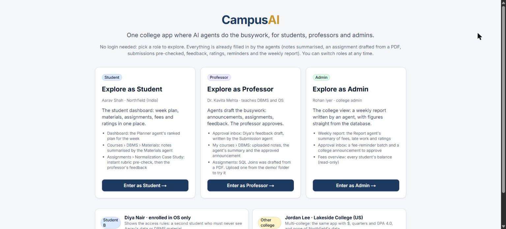
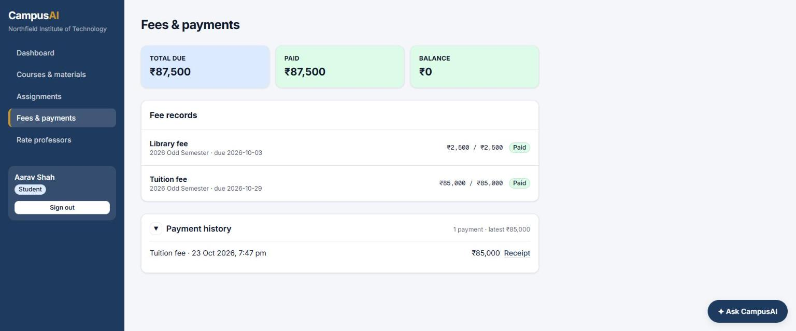

# CampusAI

**One college app where AI agents do the busywork, for students, professors and admins.**

College systems are scattered: fees in one portal, notes in another, assignments in a third, and nobody tells you what's due. CampusAI puts everything in one dashboard, and **8 agents** handle the repetitive work. They pre-check submissions against the rubric, turn an assignment PDF into a ready-to-publish assignment, summarise uploaded notes, plan each student's week, send reminders, and write the admin's weekly report. **A human approves anything that is published, sent or changes a record.** It is **built for many colleges at once**: each college has its own currency, term system and grading scale, and its data is fully isolated from every other college.

**[▶ Live demo](https://campusai-ashy.vercel.app): no login, pick a role and explore. Every agent's work is already filled in.** · [What to look at](#what-to-look-at) · [Screenshots](#screenshots) · [How to run it](#getting-started)


### At a glance

- **One app, three roles.** Students pay fees, read materials, submit work and rate professors. Professors publish materials and assignments and give feedback. Admins see a weekly college report and chase fees.
- **AI-native, not a chatbot bolted on.** Agents react to events (an upload, a submission, a rating, a schedule) and prepare the work. People just review and approve.
- **Facts come from the database, never from the AI.** Deadlines, fees and figures are loaded by code; the model only reasons and writes. The Reminder agent uses no AI at all.
- **Multi-college from day one.** One deployment serves many colleges. Each has its own settings (₹ or $, semesters or quarters, CGPA 10 or GPA 4.0), and every table carries the college's id, so data never crosses between colleges. The demo has two: Northfield (India) and Lakeside (US). Pick "Other college" to see the second one.
- **Secure by design.** Row-level security on every table checks the college first, then the role, and only Stripe's verified webhook can mark a fee paid.
- **Built with** Next.js 16 · Supabase (Postgres, pgvector, Auth, Storage) · Vercel AI SDK + Groq · Stripe · Vercel.

## Table of contents

1. [What to look at](#what-to-look-at)
2. [Demo mode](#demo-mode)
3. [The agents](#the-agents)
4. [Screenshots](#screenshots)
5. [Architecture](#architecture)
6. [Security](#security)
7. [Getting started](#getting-started)
8. [Tests](#tests)
9. [Design decisions](#design-decisions)
10. [Future scope](#future-scope)

## What to look at

Open the **[live demo](https://campusai-ashy.vercel.app)** and pick a role. **There is no login, and nothing to set up:** the agents have already run on the sample data. A "What to look at" card on each dashboard links to every feature, and the bar at the top switches roles in one click.

**As the student (Aarav)**
- **Dashboard:** the **Planner agent's** ranked plan for the week, the fee balance, deadlines, reminders and the activity feed.
- **Courses › DBMS › Materials:** lecture notes summarised by the **Materials agent**, plus the announcement the professor approved.
- **Assignments › Normalization Case Study:** the **Submission agent's** rubric pre-check and the professor's feedback.
- **Assignments › SQL Joins:** created by the **Assignment agent** from the professor's PDF (the original PDF is attached).
- **✦ Ask CampusAI:** try "Explain 3NF from our notes". The answer cites the PDF and page.

**As the professor (Dr. Mehta)**
- **Approval inbox:** Diya's feedback draft and indicative grade, written by the **Submission agent** and waiting to be approved.
- **My courses:** the uploaded notes with the agent's summary. **Assignments:** the assignment drafted from a PDF.
- **Ratings & themes:** anonymous averages and the **Feedback agent's** themes. Raw ratings are never visible.

**As the admin (Rohan)**
- **Weekly report:** the **Report agent's** summary of fees, late work and ratings, with figures straight from the database.
- **Waiting for approval:** a fee-reminder batch and a college announcement, both prepared by the agent.

**Student B and Other college** show the access rules: Diya only sees her own course and is refused Aarav's fees by the assistant, and Jordan's college (US, $, GPA) sees none of Northfield's data.

**Try it yourself (optional):** pay tuition with Stripe's test card `4242 4242 4242 4242`, submit a file, approve a draft, or upload the sample PDFs from [`demo/`](demo) as the professor to watch the agents work live. Changes are saved for real, so other visitors may see them.

## Demo mode

Reviewers pick a role instead of logging in. Each role is a seeded demo account that the server signs in on their behalf, so every page still runs through Supabase Auth and the same row-level security a real user would. A real deployment would replace this with the college's single sign-on.

| Role | Who | College |
| --- | --- | --- |
| Student | Aarav Shah | Northfield Institute of Technology (₹, semesters, CGPA 10). Enrolled in DBMS and OS |
| Student B | Diya Nair | Northfield. Enrolled in OS only, so she must never see DBMS material |
| Professor | Dr. Kavita Mehta | Northfield. Teaches DBMS (CS301) and OS (CS302) |
| Admin | Rohan Iyer | Northfield |
| Other college | Jordan Lee | Lakeside College (US: $, quarters, GPA 4.0) |

All data is fictional. `npm run demo` resets it and runs every agent on the sample files again (see [Getting started](#getting-started)).

## The agents

There are **8 agents**, grouped by who they work for: 7 use an LLM, and the Reminder agent is deliberately rule-based. The LLM agents run on one runtime (`lib/agent.ts`) that logs every run to `agent_runs`, calls the model with a fixed output schema, and records failures so the UI shows "failed — retry" instead of hiding them.

### For students

| Agent | Trigger | What it does | Human step |
| --- | --- | --- | --- |
| **Planner** | Dashboard load (cached 12 h), refresh, or chat | Ranked weekly plan from real deadlines, submission status, fees and new materials. Any link not taken from the facts is dropped | None |
| **Submission** | Student submits | Reads the file and checks it against the brief and rubric (met / partial / missing per item). The student sees this pre-check within seconds. It also drafts feedback for the professor (below) | Professor approves or edits the feedback. The final grade stays human |
| **Reminder** | Daily cron (08:00 IST) | Assignments due within 48 h with no submission, and unpaid fees due within 7 days, become reminders in the student's feed. Deduplicated per day. **Rule-based (no LLM), so it can never invent a deadline** | None (informational) |

### For professors

| Agent | Trigger | What it does | Human step |
| --- | --- | --- | --- |
| **Assignment** | Professor uploads the assignment PDF | Drafts the title, full instructions, rubric (from the PDF's marking scheme, or derived and flagged) and the deadline exactly as the PDF states it, quoting its wording. No deadline in the PDF → none invented | Professor approves or edits; the assignment is created with the original PDF attached |
| **Materials** | Professor uploads notes | After indexing, writes a summary and drafts a "new material" announcement | Professor approves before students see it |
| **Submission** (feedback side) | Student submits | The rubric check, a feedback draft and an indicative grade in the college's own scale | Approve or edit, right under the submission or in the inbox |
| **Feedback** | New or edited rating | Groups anonymous comments into themes (paraphrased; it never receives student ids) | None (read-only) |

### For the college admin

| Agent | Trigger | What it does | Human step |
| --- | --- | --- | --- |
| **Report** | Weekly cron (Mon), or "Generate report now" | The weekly college report: outstanding fees, late/missing submissions and rating themes. **Numbers come straight from SQL**; the model only writes the summary. Prepares a fee-reminder batch and, when useful, a college announcement (facts from the figures only) | Admin approves both, right under the report or in the inbox |

### For everyone

| Agent | Trigger | What it does | Human step |
| --- | --- | --- | --- |
| **CampusAI Assistant** | Chat, any role (side panel on every page) | Answers from the user's own records and course documents, citing document and page. Read-only tools, scoped by RLS; the report tool is admin-only | Refuses anything that would change a record, or anyone else's data |

## Screenshots

| | |
| --- | --- |
|  **No login:** pick a role and explore; switch roles any time |  **Student dashboard**: the Planner agent ranks the week from real deadlines and fees |
|  **Materials agent**: summary of uploaded notes and an announcement draft, approved in place |  **Assignment agent**: questions, rubric and the exact deadline extracted from the professor's PDF |
|  **Assistant**: answers from the course notes, citing the document and page |  **Submission agent**: rubric pre-check within seconds of submitting |
|  **Report agent**: the weekly college report with fee reminders and an announcement to approve |  **Fees**: paid with Stripe (test mode). Only the verified webhook can mark a fee paid, and it is recorded once even if Stripe retries |
|  **Security**: Diya asks for Aarav's fees and is refused; she only sees her own | |

## Architecture

Next.js on Vercel, with every query running as the signed-in user so Postgres row-level security decides what exists. Event agents run in the background after a request, scheduled agents run on Vercel Cron, and the Stripe webhook is the only writer of payments.

<details>
<summary><b>Diagram, stack, key files and tables</b></summary>

```
Browser ──► Next.js on Vercel (App Router, Server Components, Server Actions, Route Handlers)
              │  every user query runs AS the user (Supabase session) → Postgres RLS decides what rows exist
              │
              ├─ after()  ─► event agents (assignment, submission, materials, feedback, planner) ─► agent_runs + approvals
              ├─ /api/chat ─► CampusAI Assistant (AI SDK streamText + typed Zod tools)
              ├─ /api/cron/daily · /api/cron/weekly ─► Reminder + Report agents (Vercel Cron, Bearer CRON_SECRET)
              └─ /api/stripe/webhook ─► the ONLY writer of payments (verified signature, idempotent)

Supabase: Postgres + pgvector + RLS · Auth · private Storage buckets · Edge Function `embed` (gte-small)
AI: Groq (openai/gpt-oss-120b) behind lib/ai.ts, the one provider module
```

| Layer | Choice |
| --- | --- |
| App | Next.js 16 (App Router), TypeScript, Tailwind CSS |
| Data | Supabase Postgres + pgvector, RLS on every table, migrations in `supabase/migrations` |
| Auth | Supabase Auth, role on `profiles` |
| Files | Private Storage buckets (`materials`, `submissions`). The browser uploads via one-time signed URLs (Vercel caps request bodies at 4.5 MB). The bucket enforces PDF/TXT and ≤ 10 MB. Downloads use 60-second signed URLs after an RLS check |
| AI | Vercel AI SDK v7 + Groq. Embeddings via Supabase's built-in `gte-small` in an Edge Function (Groq has no embeddings API) |
| Payments | Stripe Checkout (test mode) + webhook |
| Jobs | Next.js `after()` for event agents, Vercel Cron for scheduled agents |

**Key files:** `lib/agent.ts` (runtime) · `lib/agents.ts` (Assignment, Submission, Materials, Feedback, Planner) · `lib/jobs.ts` (Reminder, Report) · `lib/tools.ts` (assistant tools) · `lib/ingest.ts` + `lib/chunk.ts` (RAG ingestion) · `app/(app)/inbox/actions.ts` (approval effects) · `app/api/stripe/webhook/route.ts`.

**Tables:** `institutions` (each college's settings) → `profiles`, `courses`, `enrollments`, `assignments`, `submissions`, `documents`, `document_chunks`, `fee_records`, `payments`, `announcements`, `professor_ratings`, `rating_summaries`, `agent_runs`, `approvals`, `notifications`. Every table carries `institution_id`.

</details>

## Security

Every database policy checks the **college first, then the role**, so students see only their own records, professors only their courses, and colleges never see each other. Agents and the assistant can only read, and only what the signed-in user may see.

<details>
<summary><b>Full security model</b></summary>

- **Two guards.** Every RLS policy checks the institution first, then the role or ownership. Server code adds what RLS can't express (file type, deadline, path checks). Hiding a button is never the only guard.
- **Students** see only their own fees, payments, submissions, ratings and notifications, and only courses, materials, document chunks and announcements for courses they're enrolled in.
- **Professors** see only courses they teach, and see ratings only through the anonymous `rating_aggregates` view and agent themes.
- **Agent tools** take the user from the session, never from the model. The assistant's tools are read-only, and RAG search (`match_chunks`) is `security invoker`, so chunk RLS limits it.
- **Money.** Only the Stripe webhook (verified signature, `app: campusos` tag, unique session id) can record a payment, through the atomic `record_payment()` function.
- **Writes the user shouldn't control** (submission rows, payments, feedback release, notifications) are done server-side after validation. Users have no RLS write policy on them.
- **Prompt injection.** Document and submission text is wrapped as untrusted content, and no tool can write.
- **Secrets** live only in server env vars (`.env.example` lists the names).

</details>

## Getting started

Requires Node 20+, a Supabase project, a Stripe test account and a Groq API key.

```bash
npm install
cp .env.example .env.local            # fill in the values (see below)
npx supabase db push --db-url "$SUPABASE_DB_URL"
npx supabase login && npx supabase functions deploy embed --project-ref <project-ref>
npm run dev                           # http://localhost:3000 (leave running)
npm run demo                          # seed 2 colleges + run every agent on the sample files (a few minutes)
```

**Stripe:** create a webhook destination for `checkout.session.completed` pointing to `https://<your-domain>/api/stripe/webhook`, then put its signing secret in `STRIPE_WEBHOOK_SECRET`.
**Vercel:** add the same env vars (except `SUPABASE_DB_URL`). The crons in `vercel.json` register on deploy.

<details>
<summary><b>Environment variables</b></summary>

| Variable | Used for |
| --- | --- |
| `NEXT_PUBLIC_SUPABASE_URL`, `NEXT_PUBLIC_SUPABASE_ANON_KEY` | Supabase client (public; RLS protects data) |
| `SUPABASE_SERVICE_ROLE_KEY` | Server-only: webhook, cron, background agents |
| `SUPABASE_DB_URL` | Local only: migrations and type generation |
| `GROQ_API_KEY` | LLM for agents and the assistant |
| `STRIPE_SECRET_KEY`, `STRIPE_WEBHOOK_SECRET` | Checkout + webhook verification |
| `CRON_SECRET` | Authenticates Vercel Cron calls |
| `NEXT_PUBLIC_APP_URL` | Stripe success/cancel redirects |

</details>

## Tests

Five small runnable checks prove the security rules (no student or college can see another's data, including through the assistant), payment safety, the scheduled agents and the RAG chunking.

<details>
<summary><b>What each test proves</b></summary>

Small runnable checks, no framework. `test:chunk` and `test:access` run on their own; the others need the app running (`npm run dev`, or pass the live URL as an argument).

| Script | Proves |
| --- | --- |
| `npm run test:access` | Student B can't read Student A's fees or submissions. College B sees nothing of College A. RAG search, announcements, approvals and agent runs are scoped. Professors never see raw ratings. One rating per course per term. An assignment can only attach a PDF from its own course |
| `npm run test:assistant` | Through the assistant: Student B asking for Student A's fees or submissions, a student asking for the weekly college report, "mark my fees paid", and College B asking about College A are all refused (checked on tool outputs) |
| `npm run test:webhook` | Forged signatures rejected, other apps' payments ignored, payments recorded once, replays not double-counted |
| `npm run test:cron` | Cron requires the secret, reminders match seeded deadlines, no duplicates, weekly report generated for both colleges |
| `npm run test:chunk` | RAG chunking keeps page numbers and overlap, and drops no words |

Run `npm run seed` again after `test:webhook` or `test:cron`.

</details>

## Design decisions

- **Humans approve, agents prepare.** Anything published, sent or changing a record goes through an approval, shown right where it happened and in one inbox.
- **The Reminder agent is rule-based.** Comparing dates needs no LLM, and this removes any chance of invented deadlines.
- **Chunks are ~450 tokens.** The free `gte-small` embedding model reads at most 512 tokens.
- **Groq free tier.** Agent inputs are capped at ~14k characters. The model is one line in `lib/ai.ts`.
- **Ratings anonymity** is enforced structurally (no professor access to rows, themes paraphrased). A minimum-count threshold before showing themes is the next step for real classes.

## Future scope

The MVP proves the core idea: agents prepare the work, people approve it. Next, in rough priority order:

- **More agents:** a quiz and practice-question agent built from uploaded notes, and an early-warning agent that spots students falling behind and drafts a check-in for their mentor.
- **Reach:** email, SMS and WhatsApp notifications, and an installable mobile app.
- **Ready for a whole college:** self-signup and CSV import, college Google/Microsoft sign-in, ERP and LMS integrations (Moodle, Google Classroom), and live payments with refunds (plus Razorpay/UPI).
- **Trust and quality:** an accuracy test set for every agent, ratings themes shown only above a minimum count, and an admin page listing every agent run and who approved it.
