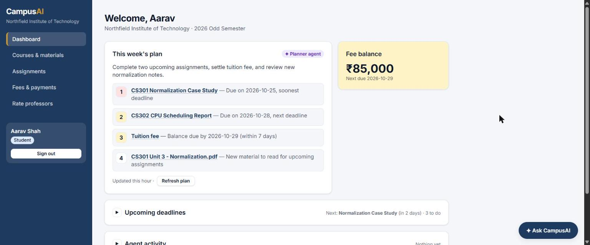
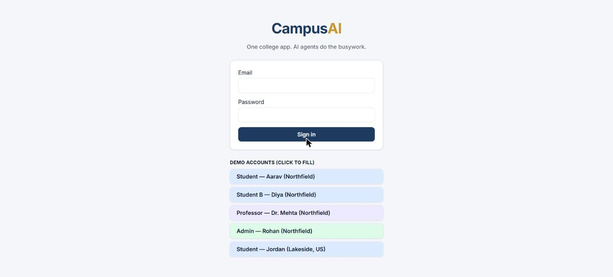
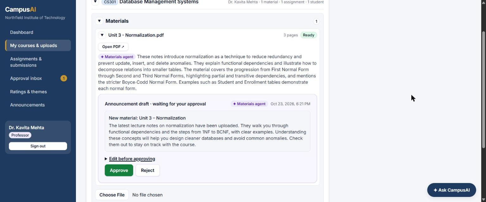
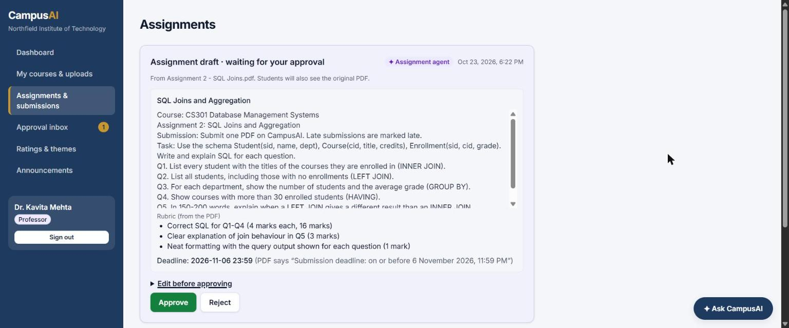
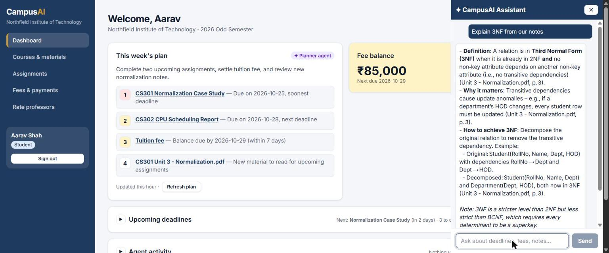
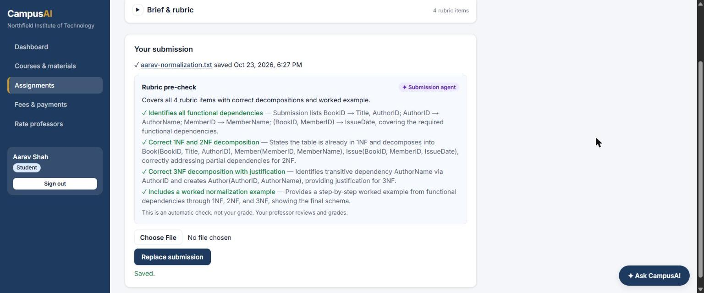
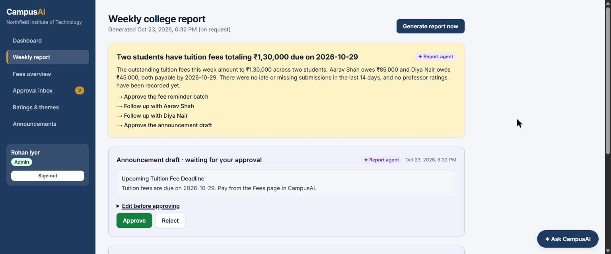
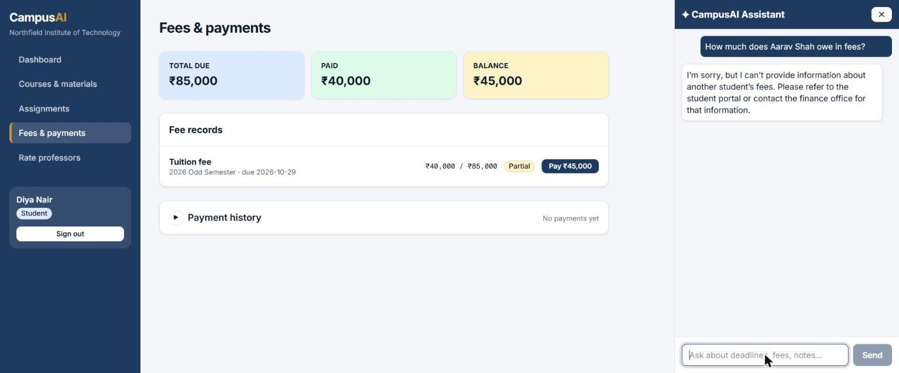

# CampusAI

**One college app where AI agents do the busywork, for students, professors and admins.**

College systems are scattered: fees in one portal, notes in another, assignments in a third, and nobody tells you what's due. CampusAI puts everything in one dashboard, and **8 AI agents** handle the repetitive work. They pre-check submissions against the rubric, turn an assignment PDF into a ready-to-publish assignment, summarise uploaded notes, plan each student's week, send reminders, and write the admin's weekly report. **A human approves anything that is published, sent or changes a record.**

**[▶ Live demo](https://campusai-ashy.vercel.app)** · [Try it in 5 minutes](#try-it-in-5-minutes) · [Demo accounts](#demo-accounts) · [Screenshots](#screenshots) · [How to run it](#getting-started)



### At a glance

- **One app, three roles.** Students pay fees, read materials, submit work and rate professors. Professors publish materials and assignments and give feedback. Admins see a weekly college report and chase fees.
- **AI-native, not a chatbot bolted on.** Agents react to events (an upload, a submission, a rating, a schedule) and prepare the work. People just review and approve.
- **Facts come from the database, never from the AI.** Deadlines, fees and figures are loaded by code; the model only reasons and writes. The Reminder agent uses no AI at all.
- **Secure by design.** Row-level security on every table, multiple colleges fully isolated, and only Stripe's verified webhook can mark a fee paid.
- **Built with** Next.js 16 · Supabase (Postgres, pgvector, Auth, Storage) · Vercel AI SDK + Groq · Stripe · Vercel.

## Table of contents

1. [Try it in 5 minutes](#try-it-in-5-minutes)
2. [Demo accounts](#demo-accounts)
3. [Features by role](#features-by-role)
4. [The agents](#the-agents)
5. [Screenshots](#screenshots)
6. [Architecture](#architecture)
7. [Security](#security)
8. [Getting started](#getting-started)
9. [Environment variables](#environment-variables)
10. [Tests](#tests)
11. [Design decisions](#design-decisions)
12. [Next steps](#next-steps)

## Try it in 5 minutes

Open the **[live demo](https://campusai-ashy.vercel.app)** and use the one-click demo accounts on the login page (password `CampusAI-demo-2026`). Download the two sample PDFs from [`demo/`](demo) first. Each step is one role; use a second browser or an incognito window to stay logged in as two people at once.

**1. Professor: publish notes** (Dr. Mehta)
My courses & uploads → DBMS → Materials → upload `Unit 3 - Normalization.pdf`. It goes Processing → Ready, the **Materials agent** writes a summary and drafts an announcement. Click **Approve** right under the file.

**2. Professor: publish an assignment from a PDF**
Assignments → New assignment → upload `Assignment 2 - SQL Joins.pdf` under CS301. The **Assignment agent** drafts the title, questions, rubric and the 6 Nov deadline, quoting the PDF. Check it and **Approve**.

**3. Student: see the week and ask questions** (Aarav)
The dashboard shows the **Planner agent's** ranked plan and the fee balance. Open **✦ Ask CampusAI** and try "Explain 3NF from our notes" (the answer cites the PDF and page) or "What should I focus on this week?".

**4. Student: submit work**
Assignments → Normalization Case Study → submit any PDF or TXT. The **Submission agent's** rubric pre-check appears within seconds.

**5. Professor: give feedback**
Open the same assignment as Dr. Mehta. The submission shows *draft to review*: edit the feedback if you like, then **Approve**. Aarav now sees it.

**6. Student: pay and rate**
Fees & payments → Pay with Stripe's test card `4242 4242 4242 4242` (any future date, any CVC) → the fee flips to Paid. Then Rate professors → give DBMS a rating. The professor only ever sees the average and anonymous themes.

**7. Admin: weekly report** (Rohan)
Weekly report → **Generate report now**. The **Report agent** summarises fees, late work and ratings from the database, and prepares a fee-reminder batch and an announcement. Approve them; the reminders land in students' activity feeds.

**8. Check the security**
As Diya, ask the assistant "How much does Aarav Shah owe in fees?" (refused). Log in as Jordan: same app, a different college with $ and GPA, and none of Northfield's data.

Everything you do is real (it's saved in the database), so other reviewers may see your test submissions or ratings. Running locally, `npm run seed` resets all demo data.

## Demo accounts

All accounts use the password **`CampusAI-demo-2026`**. The login page has one-click buttons for each.

| Role | Email | College |
| --- | --- | --- |
| Student (A) | `aarav@northfield.demo` | Northfield Institute of Technology (₹, semesters, CGPA 10). Enrolled in DBMS and OS |
| Student (B) | `diya@northfield.demo` | Northfield. Enrolled in OS only, so she must never see DBMS material |
| Professor | `prof.mehta@northfield.demo` | Northfield. Teaches DBMS (CS301) and OS (CS302) |
| Admin | `admin@northfield.demo` | Northfield |
| Student | `jordan@lakeside.demo` | Lakeside College (US: $, quarters, GPA 4.0) |
| Professor | `prof.taylor@lakeside.demo` | Lakeside |

All data is fictional. `npm run seed` resets it and moves every deadline relative to today. Two sample PDFs for trying the agents are in [`demo/`](demo).

## Features by role

| Student | Professor | Admin |
| --- | --- | --- |
| Dashboard: the Planner agent's week plan, fee balance, deadlines, agent activity, announcements | Dashboard: courses, recent submissions | Dashboard: outstanding fees, students, late submissions |
| Courses → materials (PDF + agent summary) and assignments, for enrolled courses only | My courses & uploads: PDF/TXT notes are indexed and summarised | Weekly college report (every Monday, or on demand) |
| Assignments: the brief and original PDF, submit a file, instant rubric pre-check, then the professor's feedback | Assignments: upload the assignment PDF (the agent drafts it) or create by hand; review submissions | Fees overview (read-only) |
| Fees & payments: Stripe test checkout, history, receipts | Approval inbox: assignment, feedback and announcement drafts, also approvable right where they appear | Approval inbox: fee reminder batches and college announcements |
| Rate professors (anonymous, one per course per term) | Ratings & themes (anonymous averages only) | Ratings & themes (college-wide) |
| Assistant (side panel on every page) | Assistant · Announcements | Assistant · Announcements (college-wide) |

Every page opens collapsed to one-line summaries ("Next: Normalization Case Study, in 2 days · 2 to do"), with whatever needs action already open.

## The agents

There are **8 agents**, grouped by who they work for. All run on one runtime (`lib/agent.ts`) that logs every run to `agent_runs`, calls the model with a fixed output schema, and records failures so the UI shows "failed — retry" instead of hiding them.

### For students

| Agent | Trigger | What it does | Human step |
| --- | --- | --- | --- |
| **Planner** | Dashboard load (cached 12 h), refresh, or chat | Ranked weekly plan from real deadlines, submission status, fees and new materials. Any link not taken from the facts is dropped | None |
| **Submission** | Student submits | Reads the file and checks it against the brief and rubric (met / partial / missing per item). The student sees this pre-check within seconds. It also drafts feedback for the professor (below) | Professor approves or edits the feedback. The final grade stays human |
| **Reminder** | Daily cron (08:00 IST) | Assignments due within 48 h with no submission, and unpaid fees due within 7 days, become reminders in the student's feed. Deduplicated per day. **Rule-based (no LLM), so it can never invent a deadline** | None (informational) |

### For professors

| Agent | Trigger | What it does | Human step |
| --- | --- | --- | --- |
| **Assignment** | Professor uploads the assignment PDF | Drafts the title, full instructions, rubric (from the PDF's marking scheme, or derived and flagged) and the deadline exactly as the PDF states it, quoting its wording. No deadline in the PDF → none invented | Professor approves or edits; the assignment is created with the original PDF attached |
| **Materials** | Professor uploads notes | After indexing, writes a summary and drafts a "new material" announcement | Professor approves before students see it |
| **Submission** (feedback side) | Student submits | The rubric check, a feedback draft and an indicative grade in the college's own scale | Approve or edit, right under the submission or in the inbox |
| **Feedback** | New or edited rating | Groups anonymous comments into themes (paraphrased; it never receives student ids) | None (read-only) |

### For the college admin

| Agent | Trigger | What it does | Human step |
| --- | --- | --- | --- |
| **Report** | Weekly cron (Mon), or "Generate report now" | The weekly college report: outstanding fees, late/missing submissions and rating themes. **Numbers come straight from SQL**; the model only writes the summary. Prepares a fee-reminder batch and, when useful, a college announcement (facts from the figures only) | Admin approves both, right under the report or in the inbox |

### For everyone

| Agent | Trigger | What it does | Human step |
| --- | --- | --- | --- |
| **CampusAI Assistant** | Chat, any role (side panel on every page) | Answers from the user's own records and course documents, citing document and page. Read-only tools, scoped by RLS; the report tool is admin-only | Refuses anything that would change a record, or anyone else's data |

## Screenshots

| | |
| --- | --- |
|  **Login** with one-click demo accounts for every role |  **Student dashboard**: the Planner agent ranks the week from real deadlines and fees |
|  **Materials agent**: summary of uploaded notes and an announcement draft, approved in place |  **Assignment agent**: questions, rubric and the exact deadline extracted from the professor's PDF |
|  **Assistant**: answers from the course notes, citing the document and page |  **Submission agent**: rubric pre-check within seconds of submitting |
|  **Report agent**: the weekly college report with fee reminders and an announcement to approve |  **Security**: Diya asks for Aarav's fees and is refused; she only sees her own |

## Architecture

```
Browser ──► Next.js on Vercel (App Router, Server Components, Server Actions, Route Handlers)
              │  every user query runs AS the user (Supabase session) → Postgres RLS decides what rows exist
              │
              ├─ after()  ─► event agents (assignment, submission, materials, feedback, planner) ─► agent_runs + approvals
              ├─ /api/chat ─► CampusAI Assistant (AI SDK streamText + typed Zod tools)
              ├─ /api/cron/daily · /api/cron/weekly ─► Reminder + Report agents (Vercel Cron, Bearer CRON_SECRET)
              └─ /api/stripe/webhook ─► the ONLY writer of payments (verified signature, idempotent)

Supabase: Postgres + pgvector + RLS · Auth · private Storage buckets · Edge Function `embed` (gte-small)
AI: Groq (openai/gpt-oss-120b) behind lib/ai.ts, the one provider module
```

| Layer | Choice |
| --- | --- |
| App | Next.js 16 (App Router), TypeScript, Tailwind CSS |
| Data | Supabase Postgres + pgvector, RLS on every table, migrations in `supabase/migrations` |
| Auth | Supabase Auth, role on `profiles` |
| Files | Private Storage buckets (`materials`, `submissions`). The browser uploads via one-time signed URLs (Vercel caps request bodies at 4.5 MB). The bucket enforces PDF/TXT and ≤ 10 MB. Downloads use 60-second signed URLs after an RLS check |
| AI | Vercel AI SDK v7 + Groq. Embeddings via Supabase's built-in `gte-small` in an Edge Function (Groq has no embeddings API) |
| Payments | Stripe Checkout (test mode) + webhook |
| Jobs | Next.js `after()` for event agents, Vercel Cron for scheduled agents |

**Key files:** `lib/agent.ts` (runtime) · `lib/agents.ts` (Assignment, Submission, Materials, Feedback, Planner) · `lib/jobs.ts` (Reminder, Report) · `lib/tools.ts` (assistant tools) · `lib/ingest.ts` + `lib/chunk.ts` (RAG ingestion) · `app/(app)/inbox/actions.ts` (approval effects) · `app/api/stripe/webhook/route.ts`.

**Tables:** `institutions` (each college's settings) → `profiles`, `courses`, `enrollments`, `assignments`, `submissions`, `documents`, `document_chunks`, `fee_records`, `payments`, `announcements`, `professor_ratings`, `rating_summaries`, `agent_runs`, `approvals`, `notifications`. Every table carries `institution_id`.

## Security

- **Two guards.** Every RLS policy checks the institution first, then the role or ownership. Server code adds what RLS can't express (file type, deadline, path checks). Hiding a button is never the only guard.
- **Students** see only their own fees, payments, submissions, ratings and notifications, and only courses, materials, document chunks and announcements for courses they're enrolled in.
- **Professors** see only courses they teach, and see ratings only through the anonymous `rating_aggregates` view and agent themes.
- **Agent tools** take the user from the session, never from the model. The assistant's tools are read-only, and RAG search (`match_chunks`) is `security invoker`, so chunk RLS limits it.
- **Money.** Only the Stripe webhook (verified signature, `app: campusos` tag, unique session id) can record a payment, through the atomic `record_payment()` function.
- **Writes the user shouldn't control** (submission rows, payments, feedback release, notifications) are done server-side after validation. Users have no RLS write policy on them.
- **Prompt injection.** Document and submission text is wrapped as untrusted content, and no tool can write.
- **Secrets** live only in server env vars (`.env.example` lists the names).

## Getting started

Requires Node 20+, a Supabase project, a Stripe test account and a Groq API key.

```bash
npm install
cp .env.example .env.local            # fill in the values (see below)
npx supabase db push --db-url "$SUPABASE_DB_URL"
npx supabase login && npx supabase functions deploy embed --project-ref <project-ref>
npm run seed                          # 2 colleges, 6 demo users
npm run dev                           # http://localhost:3000
```

**Stripe:** create a webhook destination for `checkout.session.completed` pointing to `https://<your-domain>/api/stripe/webhook`, then put its signing secret in `STRIPE_WEBHOOK_SECRET`.
**Vercel:** add the same env vars (except `SUPABASE_DB_URL`). The crons in `vercel.json` register on deploy.

## Environment variables

| Variable | Used for |
| --- | --- |
| `NEXT_PUBLIC_SUPABASE_URL`, `NEXT_PUBLIC_SUPABASE_ANON_KEY` | Supabase client (public; RLS protects data) |
| `SUPABASE_SERVICE_ROLE_KEY` | Server-only: webhook, cron, background agents |
| `SUPABASE_DB_URL` | Local only: migrations and type generation |
| `GROQ_API_KEY` | LLM for agents and the assistant |
| `STRIPE_SECRET_KEY`, `STRIPE_WEBHOOK_SECRET` | Checkout + webhook verification |
| `CRON_SECRET` | Authenticates Vercel Cron calls |
| `NEXT_PUBLIC_APP_URL` | Stripe success/cancel redirects |

## Tests

Small runnable checks, no framework. `test:chunk` and `test:access` run on their own; the others need the app running (`npm run dev`, or pass the live URL as an argument).

| Script | Proves |
| --- | --- |
| `npm run test:access` | Student B can't read Student A's fees or submissions. College B sees nothing of College A. RAG search, announcements, approvals and agent runs are scoped. Professors never see raw ratings. One rating per course per term. An assignment can only attach a PDF from its own course |
| `npm run test:assistant` | Through the assistant: Student B asking for Student A's fees or submissions, a student asking for the weekly college report, "mark my fees paid", and College B asking about College A are all refused (checked on tool outputs) |
| `npm run test:webhook` | Forged signatures rejected, other apps' payments ignored, payments recorded once, replays not double-counted |
| `npm run test:cron` | Cron requires the secret, reminders match seeded deadlines, no duplicates, weekly report generated for both colleges |
| `npm run test:chunk` | RAG chunking keeps page numbers and overlap, and drops no words |

Run `npm run seed` again after `test:webhook` or `test:cron`.

## Design decisions

- **Humans approve, agents prepare.** Anything published, sent or changing a record goes through an approval, shown right where it happened and in one inbox.
- **The Reminder agent is rule-based.** Comparing dates needs no LLM, and this removes any chance of invented deadlines.
- **Chunks are ~450 tokens.** The free `gte-small` embedding model reads at most 512 tokens.
- **Groq free tier.** Agent inputs are capped at ~14k characters. The model is one line in `lib/ai.ts`.
- **Ratings anonymity** is enforced structurally (no professor access to rows, themes paraphrased). A minimum-count threshold before showing themes is the next step for real classes.

## Next steps

Student self-signup and CSV import, email/SMS notifications, OCR for scanned PDFs, gradebook, ERP integration, batching the Feedback agent on a schedule.
